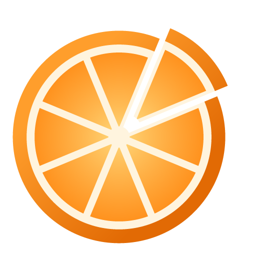
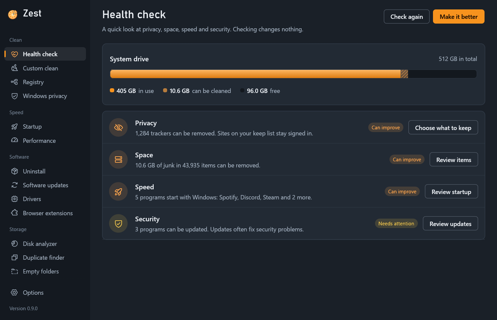
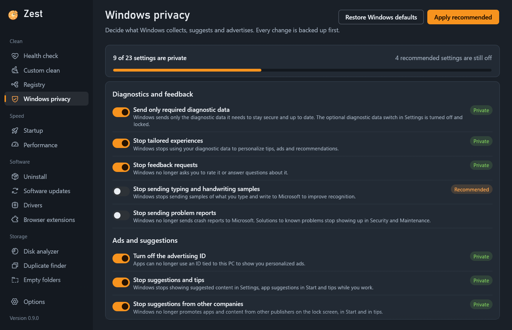
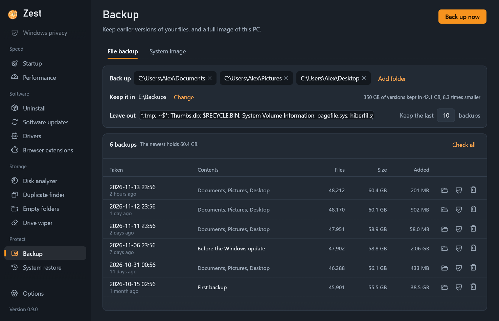
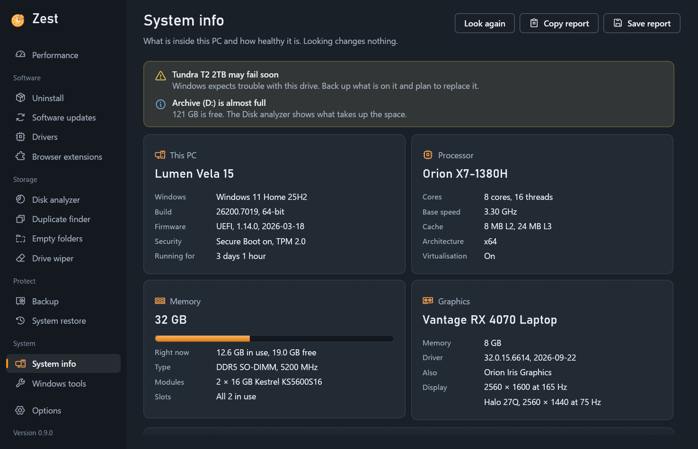

<div align="center">



# Zest

**Peel off the junk. Squeeze out the speed.**

A free, open-source PC cleaner and optimizer for Windows 10 and 11.<br>
It shows you everything before it removes anything.

[](https://github.com/SkippyNet/zest/releases/latest)
[](https://github.com/SkippyNet/zest/releases)
[](LICENSE)
[](https://github.com/SkippyNet/zest/actions/workflows/ci.yml)
[](https://github.com/SkippyNet/zest/actions/workflows/live-test.yml)
[](https://github.com/SkippyNet/zest/issues)
[](https://www.rust-lang.org/)

### [Download](https://github.com/SkippyNet/zest/releases/latest) &nbsp;·&nbsp; [Website](https://skippynet.github.io/zest/) &nbsp;·&nbsp; [Guide](https://github.com/SkippyNet/zest/wiki) &nbsp;·&nbsp; [Report a problem](https://github.com/SkippyNet/zest/issues/new/choose)

</div>



<details>
<summary><b>More screenshots</b></summary>

| | |
|---|---|
|  Custom clean: every item listed before anything is removed |  Disk analyzer: what is using the space |
|  Windows privacy: what Windows collects and shows you |  Backup: snapshots you can browse and restore |
|  System info: hardware, drive health, battery |  Light theme |

</details>

<sub>Screenshots show made-up sample data (`zest.exe --demo`).</sub>

## Download

| | | |
|---|---|---|
| **Installer** | [`Zest-<version>-x64-setup.exe`](https://github.com/SkippyNet/zest/releases/latest) | Installs for your account, no administrator rights needed, updates itself. |
| **Portable** | [`Zest-<version>-x64-portable.zip`](https://github.com/SkippyNet/zest/releases/latest) | Unzip anywhere, even a USB stick. Settings stay in its folder. |

Windows 10 (1809 or later) or Windows 11, 64-bit.

> **"Windows protected your PC"?** The files are not code-signed yet, so SmartScreen warns about
> them. Choose *More info*, then *Run anyway*, or verify the download first: every release is
> built by GitHub Actions from the tagged source and ships with `SHA256SUMS.txt` and a build
> attestation (`gh attestation verify <file> --repo SkippyNet/zest`).

## What is inside

### Clean

| | |
|---|---|
| **Health check** | Privacy, space, speed and security in one view, with one button for what is safe to fix. |
| **Custom clean** | More than 70 rules for Windows, browsers and applications. Analyze, review every item, then clean. |
| **Registry cleaner** | 15 kinds of invalid entries. Every fix is saved to a standard `.reg` file first and can be restored in one click. |
| **Windows privacy** | Switches for what Windows collects, suggests and advertises. Each one is reversible. |
| **Cookie keep list** | Stay signed in to the sites you choose while everything else is cleared. |
| **Secure deletion** | Optional 1, 3, 7 or 35-pass overwrite. |

### Speed

| | |
|---|---|
| **Startup manager** | Startup apps, scheduled tasks, services and Explorer context-menu entries, with reversible switches. |
| **Performance optimizer** | See which background apps cost processor time and memory, and put them to sleep until you use them. Boost does it in one click and undoes it afterwards. |

### Software

| | |
|---|---|
| **Uninstaller** | Runs a program's own uninstaller, then finds the folders and registry keys it left behind. Removes Microsoft Store apps too. |
| **Software updates** | Finds out-of-date programs and updates them through Windows Package Manager. It matches what is installed on *your* PC against the public catalog; there is no built-in list. |
| **Driver updates** | Signed drivers matched to your hardware, from Windows Update only. Can back up your current drivers. |
| **Browser extensions** | Every extension in every browser profile, rated by what it can access. |

### Storage

| | |
|---|---|
| **Disk analyzer** | What fills a drive: folder tree, largest files, file types. A whole drive in seconds. |
| **Duplicate finder** | Byte-for-byte identical files. Always keeps at least one copy of each. |
| **Empty folders** | Finds and removes folders that hold nothing. |
| **Drive wiper** | Wipe free space, shred files, or erase a whole drive. |

### Protect

| | |
|---|---|
| **Backup** | Versioned, deduplicated, compressed backups of your folders. Browse any snapshot, restore single files, verify integrity. |
| **System image** | A full image of the PC through Windows' own imaging engine, restorable from the Windows recovery environment. |
| **System restore** | List, create and remove restore points. |

### System

| | |
|---|---|
| **System info** | What is in the PC: processor, memory, graphics, drives with health, battery wear. |
| **Windows tools** | System file check, component repair, disk check, network reset and more: Windows' own repair commands, one click away, with their output. |

### Everywhere

| | |
|---|---|
| **Scheduled and smart cleaning** | Clean on a schedule through Task Scheduler, or let a small tray agent tell you when junk builds up. |
| **Command line** | `zest-cli` does what the app does, with `--json` for scripts. |
| **Updates itself** | Checks this repository's releases, verifies the download's checksum and installs it. |
| **Light and dark** | Follows Windows or your choice. |

## How it keeps you safe

1. **Analyze, then act.** Every tool has a read-only step that lists exactly what it would do.
   What you reviewed is what gets done.
2. **Guarded deletion.** One guard in [`crates/core/src/safety.rs`](crates/core/src/safety.rs)
   refuses Windows, program folders, your profile's own folders and anything reached through a
   junction or symbolic link, whatever a rule says. Links are never followed.
3. **Registry backups.** Registry changes are exported to a `.reg` file before they are made.
4. **Privacy rules are off by default.** Out of the box Zest removes junk. Cookies, history and
   saved passwords are only touched if you tick them.
5. **It keeps to itself.** No telemetry, no ads, no account. It goes online for its own update
   check and for the software catalog when you ask for updates; both can be switched off.

More in the [safety guide](https://github.com/SkippyNet/zest/wiki/Safety).

## How updates work

- **Zest itself** asks GitHub once a day for the newest release of this repository. If there is
  one, it downloads the installer (or the portable zip), checks it against the release's
  `SHA256SUMS.txt` and installs it. Switch the check off under *Options → About*.
- **Your software** is matched against the public Windows Package Manager catalog, on your PC.
  Zest ships no list of programs, so it works the same on a PC with entirely different software.
  Where Windows Package Manager is missing, Zest reads the catalog directly to show what is out
  of date and offers to install Windows Package Manager to do the updating.
- **Drivers** come from Windows Update and nowhere else.

## Command line

```text
zest-cli health                    privacy, space, speed and security at a glance
zest-cli analyze [--all]           what a clean would remove (changes nothing)
zest-cli clean --dry-run           the same, through the cleaning path (changes nothing)
zest-cli clean --yes               clean with your saved selection
zest-cli registry scan|fix         invalid registry entries; fix backs them up first
zest-cli privacy list|apply|revert Windows privacy settings
zest-cli tools list|run <id>       Windows' own repair tools
zest-cli startup list              everything that starts by itself
zest-cli apps list                 installed programs
zest-cli updates list              programs with updates waiting
zest-cli drivers list              third-party drivers
zest-cli disk analyze C:\Users     what uses the space under a folder
zest-cli duplicates D:\Photos      identical files
zest-cli backup create|list|restore|verify
zest-cli system                    hardware and health report
zest-cli update check              is there a newer Zest?
```

Add `--json` to any command for machine-readable output. Full reference in the
[guide](https://github.com/SkippyNet/zest/wiki/Command-line).

## Project status

Zest is at version 0.9: complete enough to use, young enough that you should read the list before
you press *Clean*.

- Every push runs the test suite on GitHub's Windows machines.
- A [live test](.github/workflows/live-test.yml) runs Zest for real on a throw-away Windows
  machine: it plants junk, cleans it, and checks that documents, fresh files and anything behind
  a junction are still there.
- [docs/FEATURES.md](docs/FEATURES.md) lists every feature and how far it has been verified.
  Some tools that need administrator rights or special hardware have only been tested on
  sandboxed data so far. If you try one on a spare PC, tell us how it went.

## Building from source

Rust 1.92 or later and the Visual Studio C++ build tools:

```powershell
git clone https://github.com/SkippyNet/zest
cd zest
cargo build --release          # target\release\zest.exe and zest-cli.exe
cargo test --workspace
```

The workspace:

| Crate | What it holds |
|---|---|
| `crates/core` | Safety guard, deletion, registry backups, directory walking, paths |
| `crates/cleaner` | Cleaning rules and the scan/clean engine |
| `crates/registry` | Registry cleaner |
| `crates/system` | Startup manager, uninstaller, System Restore |
| `crates/performance` | Live process sampling, sleep, power plans |
| `crates/updates` | Software and driver updates, Zest's own updater |
| `crates/disk` | Disk analyzer, duplicates, empty folders, wiper |
| `crates/backup` | File backups and system images |
| `crates/tweaks` | Windows privacy settings and repair tools |
| `crates/hardware` | Hardware inventory, drive and battery health |
| `crates/engine` | Settings, history, scheduling, smart cleaning |
| `crates/app` | The application (`zest.exe`) |
| `crates/cli` | The command line tool (`zest-cli.exe`) |

## Contributing and support

- **Found a problem or have an idea?** Use the [issue tracker](https://github.com/SkippyNet/zest/issues).
- **Security problem?** Please [report it privately](SECURITY.md).
- **Want to help?** Read [CONTRIBUTING.md](CONTRIBUTING.md). Testing a feature on real hardware
  is as valuable as code.

## License

[Apache License 2.0](LICENSE). Copyright 2026 Pseudo Nymm and the Zest contributors.
