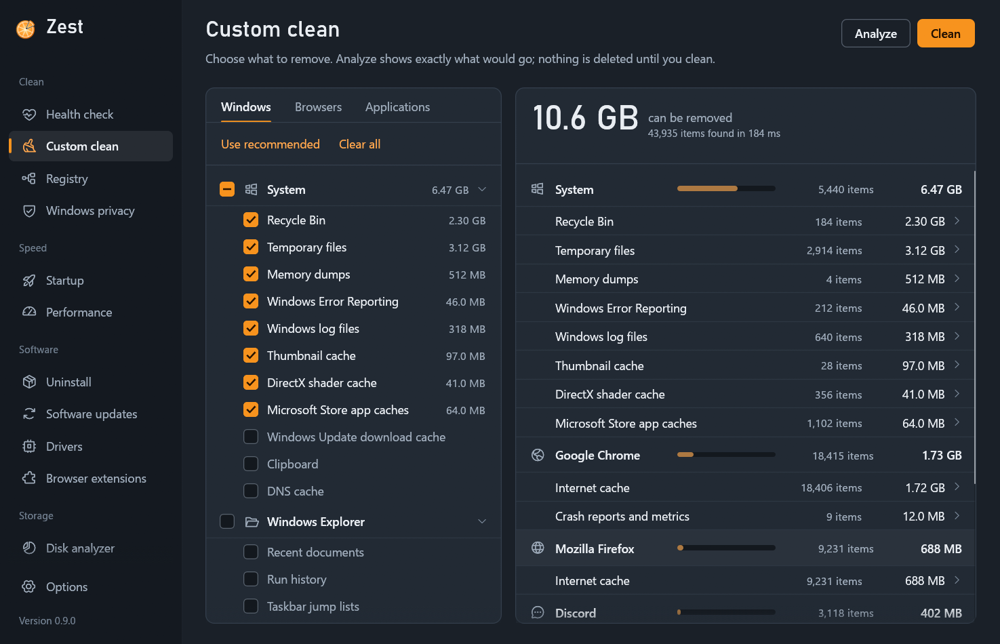
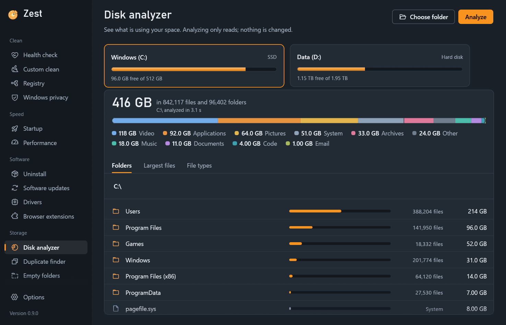
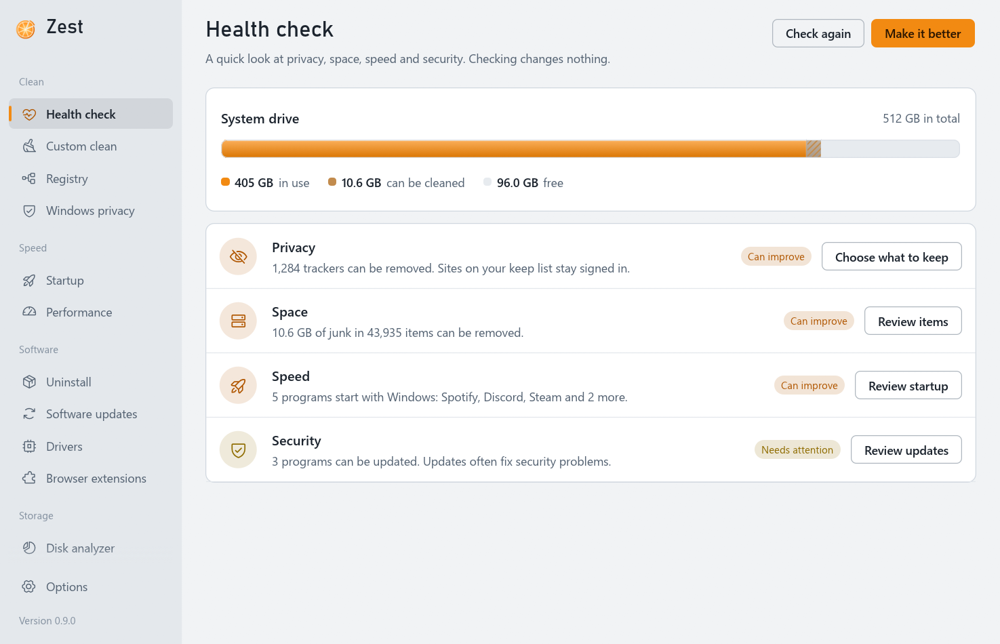

<div align="center">


# Zest

**Peel off the junk. Squeeze out the speed.** A fast, private, open-source cleaner and optimizer for Windows, written in Rust.

[](https://www.rust-lang.org/)
[](#requirements)
[](LICENSE)

</div>

Zest frees disk space, removes traces of activity, and helps you keep a Windows PC
quick and up to date. It shows you exactly what it will remove before it removes
anything, it never phones home, and the whole thing is a single native executable.


<details>
<summary>More screenshots</summary>







</details>

The screenshots show made-up sample data (`zest.exe --demo`).

## What it does

### Clean

| | |
|---|---|
| **Health check** | One pass over privacy, space, speed and security, with a single button to fix what is safe to fix. |
| **Custom clean** | 70+ cleaning rules for Windows, browsers and applications. Analyze first, review every item, then clean. |
| **Registry cleaner** | 15 categories of invalid entries. Every fix is backed up to a standard `.reg` file and can be restored in one click. |
| **Secure deletion** | Optional 1, 3, 7 or 35-pass overwrite before deletion. |
| **Cookie keep list** | Stay signed in to the sites you choose while everything else is cleared. |
| **Include and exclude** | Add your own folders to clean, and protect anything you never want touched. |

### Speed

| | |
|---|---|
| **Startup manager** | Startup apps, scheduled tasks, services and Explorer context-menu entries, with reversible on/off switches. |
| **Performance optimizer** | See which background apps cost CPU and memory, and put them to sleep until you need them. |

### Software

| | |
|---|---|
| **Uninstaller** | Runs each program's own uninstaller, then finds the folders and registry keys it left behind. |
| **Software updater** | Finds out-of-date programs and updates them from the publisher-verified Windows Package Manager sources. |
| **Driver updater** | Lists installed drivers and installs newer ones from Windows Update, where drivers are signed and matched to your hardware. |
| **Browser extensions** | Every extension in every browser profile, with a plain-language summary of how much access each one has. |

### Storage

| | |
|---|---|
| **Disk analyzer** | Scans a million files in a few seconds and shows what is using your space by type, by folder and by file. |
| **Duplicate finder** | Byte-exact duplicate detection with BLAKE3. It always keeps at least one copy. |
| **Drive wiper** | Overwrite free space so deleted files cannot be recovered, or securely shred chosen files. |

### Automation

| | |
|---|---|
| **Scheduled cleaning** | Daily, weekly, monthly or at sign-in, through the Windows Task Scheduler. Zest does not need to stay running. |
| **Smart cleaning** | An optional tray agent that tells you (or cleans) when junk passes a size you set, or when you close a browser. |
| **Multi-user cleaning** | Clean every account on the PC in one run when started as administrator. |
| **Command line** | Everything scriptable through `zest-cli`, with JSON output. |

## Why Zest

**You see everything first.** Analysis is a separate, read-only step. Its result is the exact list of files,
registry entries and operations that cleaning will act on, so what you review is what gets removed.

**It is hard to break things with it.** Every deletion in the app, from every feature, passes through one guard
that refuses critical locations no matter what asked for the deletion. See [Safety model](#safety-model).

**Private by design.** No telemetry, no account, no ads, no bundled offers. Zest itself makes no network
connections; the software and driver updaters work through Windows' own components.

**Fast and small.** Native Rust with parallel scanning throughout. Analyzing several gigabytes of junk
takes a fraction of a second, and a full system-drive analysis takes a few seconds.

**Honest about limits.** Overwriting cannot guarantee destruction on SSDs. A registry cleaner will not
make your PC faster. Zest says so where it matters instead of promising otherwise.

## Safety model

Cleaners are trusted with deleting things, so safety is designed in rather than left to each rule:

- **A single hard guard.** Drive roots, the Windows folder (outside an allow-list of temp, log and cache
  folders), Program Files, user profile folders, and system files such as the page file can never be deleted,
  even by a faulty rule or a hand-written include. The check also resolves 8.3 short names and junctions,
  so a path cannot sneak into a protected area.
- **Links are never followed.** Junctions and symbolic links are removed as links. Nothing behind them is touched.
- **Programs in use are skipped.** A browser that is running is not cleaned; files held open by other programs
  are counted as "in use", not forced.
- **Conservative by default.** Privacy rules (cookies, history, saved passwords, open tabs) are opt-in.
  Rules that remove something you might miss ask before they are enabled.
- **Reversible where possible.** Registry fixes and removed startup entries are backed up. Tools that delete
  your own files (duplicates, large files, leftovers) use the Recycle Bin by default.
- **Never guess.** "Missing target" checks only report a file as missing when the file system gives a
  definite answer on a local fixed drive. Network shares, unplugged drives and access-denied folders are
  treated as unknown.

## Requirements

- Windows 10 or Windows 11, 64-bit
- Administrator rights are optional. Zest runs as a standard user and offers to restart elevated
  only for the items that need it (system-wide temp files, machine-wide registry entries, services,
  restore points, driver installation).

## Build from source

```powershell
git clone https://github.com/SkippyNet/zest.git
cd zest
cargo build --release
```

The executables are written to `target\release\`:

| File | Purpose |
|---|---|
| `zest.exe` | The application |
| `zest-cli.exe` | The command line interface |

You need a recent stable Rust toolchain with the MSVC target and the Visual Studio C++ build tools.

## Command line

```text
zest-cli health                  Check privacy, space, speed and security
zest-cli analyze [--all]         Show what a clean would remove (changes nothing)
zest-cli clean [--dry-run]       Clean using your saved selection
zest-cli rules                   List every cleaning rule and whether it is selected
zest-cli registry scan           List invalid registry entries
zest-cli startup list            List startup apps, tasks, services and context-menu entries
zest-cli apps list               List installed programs
zest-cli updates list            List programs with updates available
zest-cli drivers list            List installed third-party drivers
zest-cli disk analyze <path>     Break down what uses space under a folder
zest-cli duplicates <path>...    Find duplicate files
```

Add `--json` to any command for machine-readable output.

## Project layout

Zest is a Cargo workspace. Each feature is its own crate with no UI code, so the engines can be
tested, reused and scripted independently.

| Crate | What it holds |
|---|---|
| `zest-core` | The safety guard, secure deletion, registry backups, path and process helpers |
| `zest-cleaner` | Junk and privacy rules, the scan and clean engines, cookie keep list, browser extensions |
| `zest-registry` | Registry scanners and fixes |
| `zest-disk` | Disk analyzer, duplicate finder, drive wiper |
| `zest-system` | Startup manager, uninstaller, System Restore |
| `zest-updates` | Software updater and driver updater |
| `zest-performance` | Process sampling, background app control, power plans |
| `zest-engine` | Settings, history, Health Check, scheduling, smart cleaning |
| `zest` | The desktop application |
| `zest-cli` | The command line interface |

Run the test suite with `cargo test --workspace`. Tests that change anything work only on temporary
folders and scratch registry keys they create themselves.

The full feature plan, with what has been verified and how, is in [docs/FEATURES.md](docs/FEATURES.md).

## Roadmap

- Signed installer and portable builds
- In-app update check
- Localization
- More application cleaning rules

## Contributing

Issues and pull requests are welcome. Cleaning rules are the easiest place to start: each one is a few
lines in `crates/cleaner/src/catalog/`, and a test checks that no rule can ever target a protected location.

## License

[Apache License 2.0](LICENSE)
